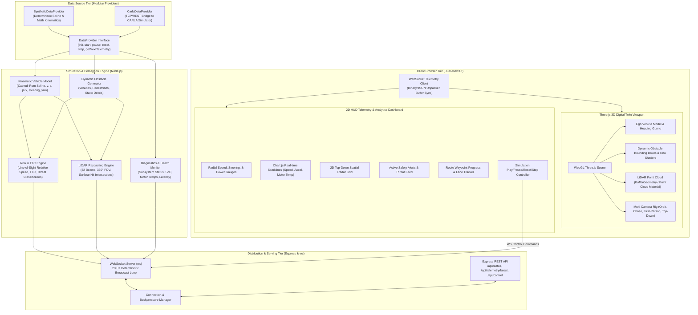
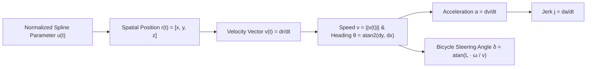
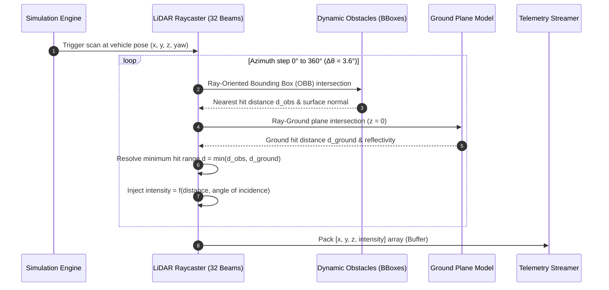
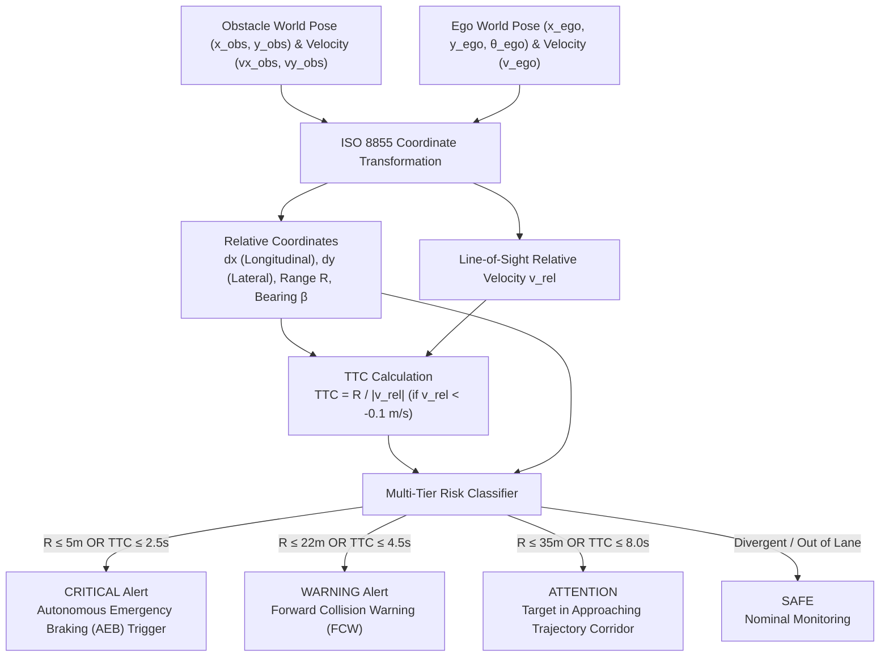
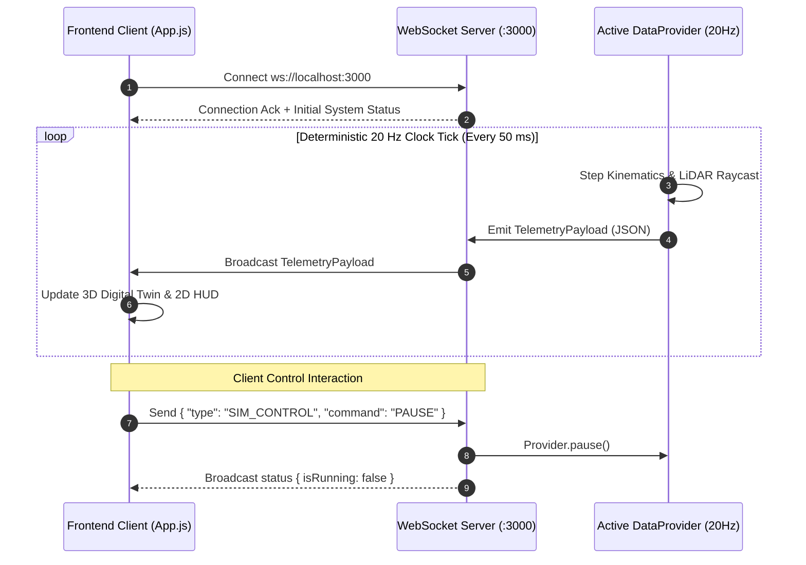
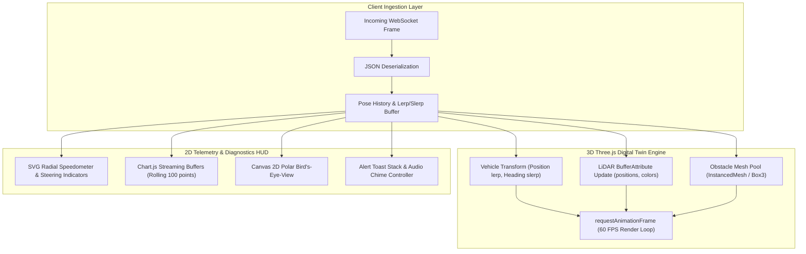

# GARUDA VISION — System Architecture & Engineering Specification

```
   ██████╗  █████╗ ██████╗ ██╗   ██╗██████╗  █████╗     ██╗   ██╗██╗███████╗██╗ ██████╗ ███╗   ██╗
  ██╔════╝ ██╔══██╗██╔══██╗██║   ██║██╔══██╗██╔══██╗    ██║   ██║██║██╔════╝██║██╔═══██╗████╗  ██║
  ██║  ███╗███████║██████╔╝██║   ██║██║  ██║███████║    ██║   ██║██║███████╗██║██║   ██║██╔██╗ ██║
  ██║   ██║██╔══██║██╔══██╗██║   ██║██║  ██║██╔══██║    ╚██╗ ██╔╝██║╚════██║██║██║   ██║██║╚██╗██║
  ╚██████╔╝██║  ██║██║  ██║╚██████╔╝██████╔╝██║  ██║     ╚████╔╝ ██║███████║██║╚██████╔╝██║ ╚████║
   ╚═════╝ ╚═╝  ╚═╝╚═╝  ╚═╝ ╚═════╝ ╚═════╝ ╚═╝  ╚═╝      ╚═══╝  ╚═╝╚══════╝╚═╝ ╚═════╝ ╚═╝  ╚═══╝
```

---

## 1. Executive Summary

**GARUDA VISION** is an enterprise-grade, high-fidelity Digital Twin and Real-Time Telemetry Visualization Platform engineered for Autonomous Ground Vehicles (AGVs) and Level 4/5 autonomous driving stacks. 

The system bridges physical/simulated vehicular kinematics, spatial perception (32-beam LiDAR raycasting, radar, bounding-box tracking), edge diagnostics, and collision risk estimation into a unified, high-performance web dashboard operating at a deterministic **20 Hz** streaming rate over full-duplex WebSockets.

GARUDA VISION is architected with strict separation of concerns, zero telemetry drift, modular provider abstraction (interchangeable between analytical synthetic simulation and CARLA Simulator), and zero-garbage-collection rendering loops in Three.js and Chart.js.

---

## 2. High-Level System Architecture

The following block diagram illustrates the end-to-end data flow and subsystem boundaries across the GARUDA VISION platform:



---

## 3. Modular Data-Source Architecture

GARUDA VISION decouples the visualization and telemetry ingestion pipelines from the underlying physics engine through a standardized **DataProvider Contract**. The platform supports hot-swapping between the **SyntheticDataProvider** and the **CarlaDataProvider** without requiring client reconnects or payload mutations.

### 3.1 The DataProvider Contract (`IDataProvider`)

Every telemetry provider implements an identical lifecycle interface:

```javascript
class IDataProvider {
  /**
   * Initializes internal buffers, waypoints, and socket connectors.
   * @param {Object} options Configuration options (rateHz, noise, port)
   * @returns {Promise<void>}
   */
  async init(options) {}

  /**
   * Starts the autonomous generation / streaming loop.
   */
  start() {}

  /**
   * Freezes simulation time while preserving vehicle state.
   */
  pause() {}

  /**
   * Resets vehicle position, obstacles, and odometry to origin (t = 0).
   */
  reset() {}

  /**
   * Advances simulation time by exactly one discrete delta-t (e.g. 50ms at 20Hz).
   */
  step() {}

  /**
   * Retrieves the current standardized telemetry frame conforming to TELEMETRY_SCHEMA v1.0.0.
   * @returns {TelemetryPayload}
   */
  getNextTelemetry() {}

  /**
   * Returns current provider diagnostic status.
   * @returns {{ name: string, active: boolean, tick: number, health: string }}
   */
  getStatus() {}
}
```

### 3.2 Provider Comparison Matrix

| Architectural Feature | SyntheticDataProvider | CarlaDataProvider |
| :--- | :--- | :--- |
| **Execution Environment** | Node.js native runtime (Zero external dependencies) | External Unreal Engine 4/5 CARLA Daemon |
| **Kinematic Model** | Analytical Catmull-Rom spline with derivative calculus | PhysX multi-body vehicle dynamics |
| **LiDAR Generation** | Raycasting against 3D bounding boxes + ground plane | Raycast LiDAR sensor plugin inside CARLA world |
| **Deterministic Replay**| 100% bit-exact across test suites and benchmark runs | Dependent on CARLA fixed-delta-time physics tick |
| **Latency / Compute** | < 1.5 ms per frame generation | Variable (Network IPC + CARLA server render tick) |
| **Disclaimer Flag** | `"SYNTHETIC / SIMULATED DATA"` | `"CARLA SIMULATOR BRIDGE / SIMULATED DATA"` |

---

## 4. Deterministic Kinematic Vehicle Model

In autonomous vehicle software, arbitrary random-number telemetry generation is unacceptable: it produces unphysical acceleration discontinuities, violating $F = ma$, and causes numerical instability in downstream controllers. GARUDA VISION employs an analytical trajectory model based on closed-loop Catmull-Rom splines with continuous higher-order derivatives.



### 4.1 Mathematical Formulation

Let the planned trajectory be defined by an ordered set of control waypoints $\mathbf{P}_0, \mathbf{P}_1, \dots, \mathbf{P}_{N-1} \in \mathbb{R}^3$. For any normalized spline progress parameter $u \in [0, 1)$ between waypoints $\mathbf{P}_{i-1}, \mathbf{P}_i, \mathbf{P}_{i+1}, \mathbf{P}_{i+2}$, the continuous spatial coordinate is evaluated using the Catmull-Rom cubic polynomial:

$$\mathbf{r}(u) = \frac{1}{2} \begin{bmatrix} 1 & u & u^2 & u^3 \end{bmatrix} \begin{bmatrix} 0 & 2 & 0 & 0 \\ -1 & 0 & 1 & 0 \\ 2 & -5 & 4 & -1 \\ -1 & 3 & -3 & 1 \end{bmatrix} \begin{bmatrix} \mathbf{P}_{i-1} \\ \mathbf{P}_i \\ \mathbf{P}_{i+1} \\ \mathbf{P}_{i+2} \end{bmatrix}$$

#### Velocity & Heading
The spatial tangent vector is the analytical first derivative with respect to parameter $u$:

$$\mathbf{t}(u) = \frac{d\mathbf{r}}{du} = \frac{1}{2} \begin{bmatrix} 0 & 1 & 2u & 3u^2 \end{bmatrix} \mathbf{M}_{\text{CR}} \mathbf{P}_{\text{local}}$$

The instantaneous velocity in the world horizontal plane ($XY$) is:

$$\mathbf{v}(t) = \frac{d\mathbf{r}}{dt} = \frac{d\mathbf{r}}{du} \cdot \frac{du}{dt}$$

The scalar speed and vehicle yaw angle (heading) are computed directly from the velocity vector:

$$v(t) = \sqrt{\dot{x}^2(t) + \dot{y}^2(t)}$$

$$\theta(t) = \operatorname{atan2}(\dot{y}(t), \dot{x}(t))$$

#### Derivative Kinematics (Acceleration, Jerk, Yaw Rate)
To ensure passenger comfort and structural feasibility:

$$a(t) = \frac{v(t) - v(t - \Delta t)}{\Delta t}$$

$$j(t) = \frac{a(t) - a(t - \Delta t)}{\Delta t} \quad \text{(Longitudinal Jerk)}$$

$$\omega(t) = \frac{\theta(t) - \theta(t - \Delta t)}{\Delta t} \quad \text{(Yaw Rate in rad/s)}$$

#### Kinematic Bicycle Model (Ackermann Steering)
Given vehicle wheelbase $L = 2.85\text{ m}$, the equivalent front-wheel steering angle $\delta(t)$ required to sustain yaw rate $\omega(t)$ at speed $v(t)$ is modeled as:

$$\delta(t) = \arctan\left(\frac{L \cdot \omega(t)}{v(t) + \epsilon}\right)$$

### 4.2 Sensor Noise Modeling

To benchmark Kalman filter tracking under realistic conditions, the simulation injects controlled sensor noise:
- **Gaussian White Noise (Box-Muller)**: Adds zero-mean stochastic disturbance $w \sim \mathcal{N}(0, \sigma^2)$ to speed ($\sigma = 0.15\text{ m/s}$), positioning ($\sigma = 0.08\text{ m}$), and steering angle ($\sigma = 0.2^\circ$).
- **Systematic Bias**: Simulates IMU calibration drift ($\dot{\theta}_{\text{bias}} = 0.02^\circ/\text{s}$).

---

## 5. Spatial Obstacle & LiDAR Raycasting Engine

GARUDA VISION features a built-in LiDAR simulation modeled after a **32-channel spinning mechanical LiDAR** (e.g., Velodyne Ultra Puck / Hesai Pandar XT32) capable of sweeping $360^\circ$ azimuth and $-25^\circ$ to $+15^\circ$ elevation.



### 5.1 Raycasting Algorithm

1. **Azimuth & Elevation Discretization**:
   The LiDAR sweeps $M = 100$ azimuth azimuth slices across 32 vertical rings, yielding 800 to 1,200 active point hits per scan frame.
   
   $$\mathbf{d}_{\text{ray}} = \begin{bmatrix} \cos(\phi) \cos(\theta) \\ \cos(\phi) \sin(\theta) \\ \sin(\phi) \end{bmatrix}$$
   
   where $\theta \in [0, 2\pi)$ is azimuth in vehicle coordinates, and $\phi \in [-25^\circ, +15^\circ]$ is elevation.

2. **Obstacle Intersection (Ray-OBB)**:
   Obstacles are modeled as 3D Oriented Bounding Boxes (OBB) with extents $(L, W, H)$. The ray is transformed into the obstacle's local coordinate frame via inverse transformation:
   
   $$\mathbf{p}_{\text{local}} = \mathbf{R}_{\text{obs}}^{-1} (\mathbf{p}_{\text{ray}} - \mathbf{p}_{\text{obs}})$$
   
   Fast slab-method ray-AABB tests determine intersection intervals $[t_{\min}, t_{\max}]$.

3. **Ground Plane & Intensity Calculation**:
   Ray hits on the ground surface ($z = 0$) simulate road reflectivity. Reflected intensity $I \in [0, 1]$ is computed using the inverse-square law attenuated by incidence cosine:
   
   $$I = \rho \cdot \frac{\cos(\alpha)}{d^2 + 1.0}$$
   
   where $\rho$ is material reflectivity ($\rho_{\text{metal}} = 0.9, \rho_{\text{asphalt}} = 0.35, \rho_{\text{pedestrian}} = 0.2$).

---

## 6. Collision Risk Assessment & Time-To-Collision (TTC)

Perception stacks must calculate relative threats independently of vehicle heading. GARUDA VISION converts all obstacle vectors from the global frame into the **Ego Vehicle Frame (ISO 8855 standard)**.



### 6.1 Coordinate Transformation (World to Ego Frame)

Given ego position $(x_e, y_e)$ and heading angle $\theta_e$ (radians, where $0 = +X$, $\frac{\pi}{2} = +Y$):

$$\begin{bmatrix} \Delta x_{\text{ego}} \\ \Delta y_{\text{ego}} \end{bmatrix} = \begin{bmatrix} \cos\theta_e & \sin\theta_e \\ -\sin\theta_e & \cos\theta_e \end{bmatrix} \begin{bmatrix} x_{\text{obs}} - x_e \\ y_{\text{obs}} - y_e \end{bmatrix}$$

- $\Delta x_{\text{ego}}$: Longitudinal displacement (positive forward, negative rear).
- $\Delta y_{\text{ego}}$: Lateral displacement (positive left, negative right).
- $\text{Range } R = \sqrt{\Delta x_{\text{ego}}^2 + \Delta y_{\text{ego}}^2}$.
- $\text{Relative Bearing } \beta = \operatorname{atan2}(\Delta y_{\text{ego}}, \Delta x_{\text{ego}}) \in [-180^\circ, +180^\circ]$.

### 6.2 Line-of-Sight Approach Rate & Time-To-Collision

Let the ego velocity vector in world coordinates be $\mathbf{v}_e = [v_e \cos\theta_e, v_e \sin\theta_e]^T$ and obstacle velocity be $\mathbf{v}_o = [v_{ox}, v_{oy}]^T$. The relative velocity vector is:

$$\mathbf{v}_{\text{rel}} = \mathbf{v}_o - \mathbf{v}_e$$

The rate of range change (range rate / closing speed) is the projection of relative velocity onto the line-of-sight unit vector $\hat{\mathbf{r}} = \frac{\mathbf{r}_o - \mathbf{r}_e}{\|\mathbf{r}_o - \mathbf{r}_e\|}$:

$$\dot{R} = \mathbf{v}_{\text{rel}} \cdot \hat{\mathbf{r}} = \frac{(v_{ox} - v_{ex})(x_o - x_e) + (v_{oy} - v_{ey})(y_o - y_e)}{R}$$

- If $\dot{R} \ge -0.1\text{ m/s}$: The target is opening distance or moving tangentially; $TTC = \text{null}$ (no collision imminent).
- If $\dot{R} < -0.1\text{ m/s}$: The target is closing in; the instantaneous Time-To-Collision is:

$$TTC = \frac{R}{|\dot{R}|}$$

### 6.3 Risk Classification Hierarchy

1. **`CRITICAL`** (AEB activation threshold):
   - $R \le 5.0\text{ m}$ (Immediate safety perimeter breach), OR
   - Target in travel corridor ($|\Delta y_{\text{ego}}| \le 2.2\text{ m}$) with $TTC \le 2.5\text{ s}$, OR
   - $R \le 10.0\text{ m}$ closing at rate $\dot{R} < -1.0\text{ m/s}$.
2. **`WARNING`** (FCW activation threshold):
   - Target in travel lane with $TTC \le 4.5\text{ s}$ or $R \le 22.0\text{ m}$ closing, OR
   - Target in adjacent buffer corridor ($|\Delta y_{\text{ego}}| \le 3.8\text{ m}$) with $TTC \le 3.2\text{ s}$ or $R \le 14.0\text{ m}$.
3. **`ATTENTION`**:
   - $TTC \le 8.0\text{ s}$, OR target within $35.0\text{ m}$ and $|\beta| < 70^\circ$.
4. **`SAFE`**:
   - All other non-intersecting or divergent obstacles.

---

## 7. Full-Duplex WebSocket Telemetry Pipeline



### 7.1 Networking Protocol Specifications

- **Transport**: Full-duplex RFC 6455 WebSockets over TCP.
- **Port**: Default `3000` (co-hosted on HTTP Express server).
- **Default Emit Frequency**: $20\text{ Hz}$ ($50\text{ ms}$ interval), configurable to $10, 20, 30, 50\text{ Hz}$.
- **Serialization**: Compact JSON with zero deep-nested circular references.
- **Backpressure Handling**: If a connected client socket buffer (`bufferedAmount`) exceeds $64\text{ KB}$, the server drops intermediate non-critical LiDAR point clouds while guaranteeing continuous header and vehicle alert delivery to prevent visual stalling.

---

## 8. Dual-View UI Architecture



### 8.1 Three.js 3D Digital Twin Optimizations
To sustain silky-smooth 60+ FPS on client browsers while ingesting 20 Hz dense LiDAR point clouds:
1. **`BufferGeometry` & `BufferAttribute` Reuse**: The LiDAR point cloud geometry allocates a fixed-size `Float32Array(MAX_POINTS * 3)` during initialization. Incoming points are written directly into existing memory slices, followed by `positionAttribute.needsUpdate = true`. Memory allocations inside the render loop are strictly zero.
2. **Object Pooling**: Obstacle bounding boxes and collision cones are pre-instantiated in an object pool. Meshes are activated/deactivated via `.visible = true/false` rather than being added/removed from the Three.js scene graph.
3. **Multi-Camera Camera Rig**:
   - *Chase Cam*: Third-person smooth tracking behind vehicle longitudinal axis.
   - *Orbit Cam*: Free 360-degree rotational inspection.
   - *First-Person (Cockpit)*: Driver's vantage point.
   - *Top-Down (Bird's Eye)*: Orthographic-like spatial overview.

### 8.2 2D HUD Telemetry & Analytics Dashboard
- **Speed & Dynamics Display**: High-visibility digital readout with acceleration and longitudinal jerk meters.
- **Chart.js Rolling Window**: Real-time multi-series graphs maintaining a rolling buffer of 100 points ($5\text{ s}$ duration at 20 Hz), rendering speed, motor temperatures, and battery drain.
- **Top-Down 2D Radar Canvas**: A dedicated polar coordinate radar showing ego vehicle center, lane corridors, and color-coded obstacle markers (Green: SAFE, Yellow: ATTENTION, Orange: WARNING, Red: CRITICAL).

---

## 9. Security, Robustness & Fail-Safe Mechanisms

- **Synthetic Data Disclaimer**: Every packet carries `header.isSimulated = true` and `header.disclaimer = "SYNTHETIC / SIMULATED DATA - NOT PHYSICAL SENSOR MEASUREMENTS"` to prevent downstream integration confusion with physical drive logs.
- **Subsystem Degradation Modes**: When telemetry detects degraded sensor states (e.g., LiDAR blinded or compute latency $> 50\text{ ms}$), the system automatically triggers fallback `DEGRADED` health status and broadcasts warning alerts.
- **Emergency Braking Simulation**: When `CRITICAL` proximity ($TTC < 2.5\text{ s}$) is sustained for $> 100\text{ ms}$, the kinematic controller initiates maximum deceleration ($a = -6.5\text{ m/s}^2$) bringing the vehicle to an automated stop.
